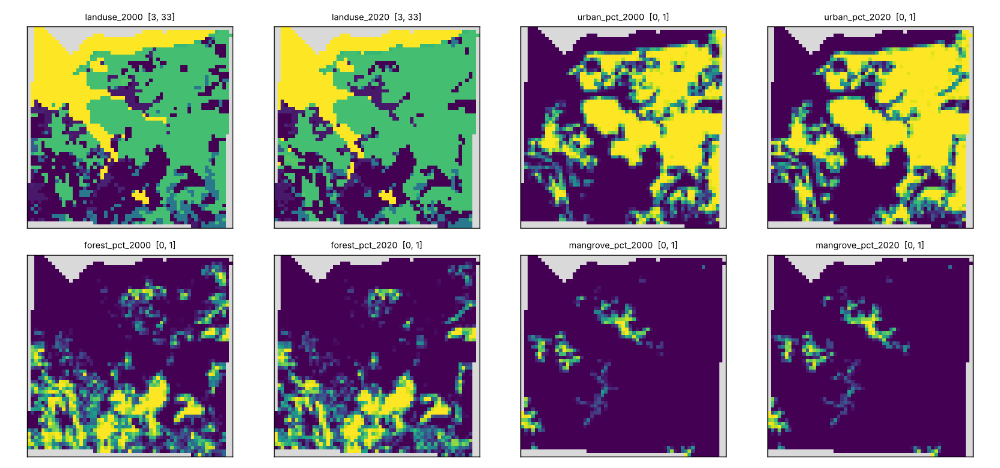
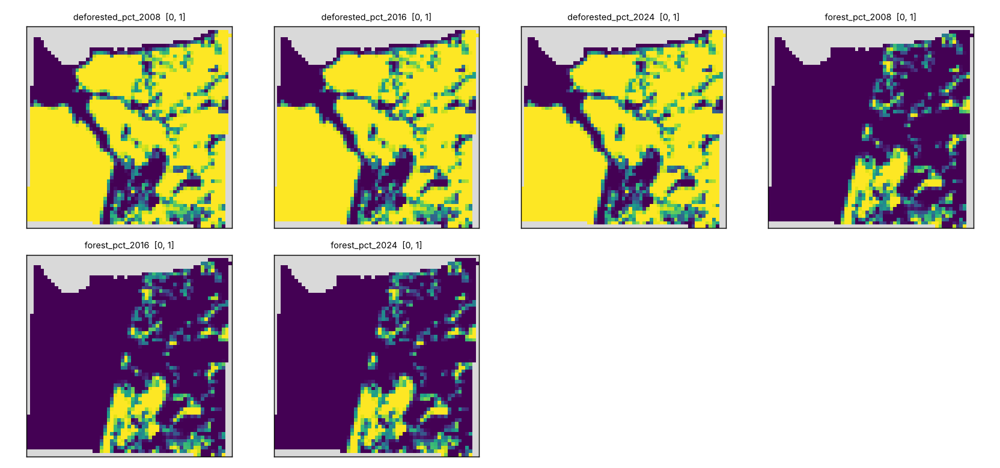
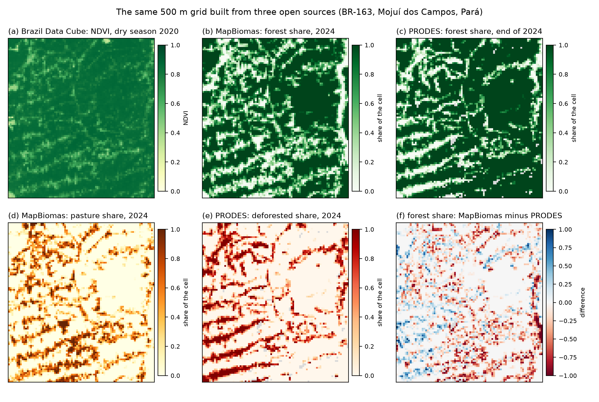

# disscube-grids

How to build gridded variables ("cellular spaces") from open data with
[DisSCube](https://github.com/DisSModel/disscube): one study area per folder, one TOML file per
grid, a few lines of shell to run it, and the maps it produces.

The point is the **grid construction**: each pipeline file states the grid (snapped to the
[Brazil Data Cube](https://brazil-data-cube.github.io/) Albers mesh), the sources and how each
variable is derived. There is no case-specific code; the only shared script is
`common/plot_cube.py`, which draws the maps.

| Area | Pipeline | Sources | Grid | Status |
|---|---|---|---|---|
| `ilha_maranhao/` | `bdc_mapbiomas.toml` | BDC Landsat indices (STAC), MapBiomas, PRODES | 300 m, 58 × 59 cells | MapBiomas half **ran here** (10 Oct 2026, DisSCube 0.5.0); BDC half not run (STAC unreachable from the build machine) |
| `para/` | `sources.toml` | MapBiomas (collection 11, level-1 land use), PRODES | 5 km, whole state, about 284 × 276 cells | **to run** (needs DisSCube with block reading, see below); the same file ran on the Acre at 1 km |
| `para/` | `bdc_ndvi.toml` | BDC Landsat NDVI (STAC) | same | not run: the BDC adapter still reads whole windows |
| `br163/` | `prodes.toml` | PRODES (Legal Amazon) | 500 m, 94 × 86 cells | **ran here** (10 Oct 2026, DisSCube 0.5.0) |
| `br163/` | `bdc_mapbiomas.toml` | BDC Landsat NDVI (STAC), MapBiomas | same | MapBiomas half **ran here** (11 Oct 2026, DisSCube 0.5.0); BDC half: to run (needs access to the BDC STAC service) |
| `amazonia_legal/` | `prodes.toml` | PRODES (Legal Amazon) | 5.28 km, whole region, 680 × 520 cells | the tile script **ran** for the whole region (884 tiles); the single TOML **ran here** on 3 × 3 tiles (agrees with it); whole region: to run (needs the block-reading DisSCube) |
| `brasil_5km/` | `mapbiomas.toml` | MapBiomas (collection 11, 30 m) | 5.28 km, 900 × 1,040 cells | single TOML **ran here** on 2 tiles (agrees with the tile script); whole country: to run (needs the block-reading DisSCube) |

## First results (Ilha do Maranhão, 10 Oct 2026)

MapBiomas (collection 11) on the 300 m BDC-snapped grid: 3,083 of 3,422 cells have data; urban share
41.4 % (2000) → 47.5 % (2020), forest 22.8 % → 19.4 %, mangrove 4.1 % → 4.5 %, the same figures
as the earlier run in `disscube-recipes`. It takes about 6 s after the download.


`ilha_maranhao/figure_sources.py` draws the island with the BDC indices (NDVI and MNDWI, when `bdc_mapbiomas.toml` has been
run) and the MapBiomas land use, urban and mangrove shares and the urban change from 2000 to 2020
(`python figure_sources.py` in `ilha_maranhao/`; the PRODES maps are left out, see below).

PRODES (edition `prodes_amazonia_legal_2025_v20260408`) returns data in 2,897 of the 3,422 cells,
so the island is inside its domain. **It is not a good demonstration**: the south-west shows a
straight-edged block that is entirely "deforested" in every year, which looks like an artefact of
the PRODES domain edge (the island lies at the limit of the Legal Amazon) and not like land cover.
The PRODES source is kept in `bdc_mapbiomas.toml` (variables prefixed `prodes_`) as the record of this test, so the island is
built from three sources in one file; PRODES is shown as a useful map on `br163/` instead.


PRODES on the BR-163 near Mojuí dos Campos (500 m grid, 94 × 86 cells, 7,997 of 8,084 cells with data,
about 5 s after the download): deforested share 18.1 % (2008) → 20.1 % (2016) → 20.5 % (2024); forest
81.6 % → 79.5 % → 79.2 %. The maps show the fishbone pattern of the road's side roads.


### Three sources on one grid (BR-163)

`br163/bdc_mapbiomas.toml` uses the same area and 500 m grid as `br163/prodes.toml` (the LuccME Lab15 cellular
space), so that the Brazil Data Cube (Landsat NDVI, dry season 2020), MapBiomas (collection 11) and PRODES can be read
cell by cell. `br163/figure_sources.py` draws them together (forest share from MapBiomas and from PRODES, pasture and
deforested share, and the difference between the two forest shares). It is an illustration of how the same declarative
file starts from different open sources, not a validation: the sources define forest differently and are not expected to
agree cell by cell. The BDC panel stays empty until `bdc_mapbiomas.toml` has been run.


Two things found while running, both in DisSCube 0.5.0: `disscube export` as a separate command
looks the grid up by its name (`ilha_do_maranhao`) while the cube stores `ilha_do_maranhao/300m`, and
fails; `run --output` exports correctly, which is what `run.sh` uses. And the process ends with an
`Error in sys.excepthook` message after the work is done (output is complete).

### PRODES over the whole Legal Amazon (`amazonia_legal/`)

One pipeline file, `prodes.toml`, for the whole region: PRODES (2008 and 2024) on the BDC Albers mesh, 5.28 km cells (680 × 520, the
cells of the BDC_SM tiles). The PRODES raster has 9.7 billion pixels, so it needs a DisSCube that reads and aligns by blocks (branch
`feat/out-of-core-sources` of [DisSModel/disscube](https://github.com/DisSModel/disscube), not yet merged: change this note when it
is); 0.5.0 as released stops for lack of memory. Bands: `prodes_deforested_pct_<year>`, `prodes_forest_pct_<year>`.
`figure_prodes.py` draws the map (`docs/amazonia_prodes.png`). This replaces the tile script that ran the same pipeline 884 times
(`build_prodes_amazonia.py`); on a window of 3 × 3 tiles the two agree to 0.4 % of a cell at most.

```bash
cd amazonia_legal && ./run.sh all          # validate, run (network), export GeoTIFF, plot
```

## The state of Pará (`para/`)

One pipeline file, `sources.toml`, for the whole state: MapBiomas 2024 (30 m) and PRODES 2024, on a 5 km grid snapped to the BDC
Albers mesh. Pará lies entirely inside the Legal Amazon, so PRODES covers all of it. Each window is about 2.2 billion pixels, so it
needs a DisSCube that reads and aligns by blocks (branch `feat/out-of-core-sources` of
[DisSModel/disscube](https://github.com/DisSModel/disscube), not yet merged: change this note when it is). With 0.5.0 as released it
stops for lack of memory; the same file on the Acre (430 million pixels, 1 km) ran with 1.3 GB.

- **Land use:** `l1_class` is the MapBiomas class that covers most of the cell, at **MapBiomas level 1** (1 Forest, 2 Herbaceous and
  shrubby vegetation, 3 Farming, 4 Non vegetated area, 5 Water), through `[derive.params.groups]`, a list of leaf codes per class
  ([Collection 11 legend codes](https://brasil.mapbiomas.org/downloads/codigos-de-legenda/)). Code 91 appears in the 2024 map and is
  placed under non-vegetated area by assumption: check it in the legend CSV. For the share of the cell in a class instead of the
  dominant one, `percentage` takes a list: `class_code = [3, 4, 5, 6, 49]`.
- **PRODES:** `prodes_class` is the class that covers most of the cell: forest, deforested up to 2024, other (non-forest vegetation) and
  water (hydrography, kept apart by `separate_water = true` on the source: PRODES alone folds it into other; clouds are no data). For the deforested share, `percentage` with `class_code = 2`.
- `figure_sources.py` draws the sources side by side (`docs/para_sources.png`): (a) MapBiomas level-1 land use, (b) PRODES classes and,
  with `--bdc` pointing to the GeoTIFF of `bdc_ndvi.toml`, (c) the BDC NDVI. Cells outside the state are masked using the IBGE
  boundary ([`PA_UF_2025.zip`](https://geoftp.ibge.gov.br/organizacao_do_territorio/malhas_territoriais/malhas_municipais/municipio_2025/UFs/PA/PA_UF_2025.zip), IBGE territorial mesh 2025, kept in the folder).
- `bdc_ndvi.toml` is the Brazil Data Cube NDVI on the same grid, **not run**: the BDC adapter reads every scene of the period whole,
  which does not fit over the state. Use a smaller `extent`, or the island (`ilha_maranhao/`).

```bash
cd para && ./run.sh run sources && ./run.sh plot sources      # network; 2 derivations, each a pass over about 2 billion pixels
```

## Run

```bash
python -m venv .venv && source .venv/bin/activate
pip install -r requirements.txt
cd ilha_maranhao && ./run.sh all            # validate, run (network), export GeoTIFF, plot
cd ../br163 && ./run.sh run prodes && ./run.sh run bdc_mapbiomas && python figure_sources.py   # three sources on one grid
./run.sh validate bdc_mapbiomas             # any step, any pipeline of the folder
```

Maps are written to `<area>/images/<pipeline>/` (git-ignored; the ones shown in this README are
copied to `docs/`).

## What each area tests

- **Sources with different geometry on one grid:** BDC composites (raster, STAC), MapBiomas
  (30 m classes), PRODES (Legal Amazon only, years from 2007).
- **Cost:** `brasil_5km` is the large case: MapBiomas at 30 m over Brazil is about 9.4 billion pixels. It is one TOML that needs a
  DisSCube reading by blocks (branch `feat/out-of-core-sources`, not yet merged); with 0.5.0 as released it does not fit in memory.

## Notes

- Data are fetched from the providers when a case runs; the repository holds text and a few images.
  Check each provider's terms before reusing the data.
- BDC and PRODES results depend on the catalog contents and on the PRODES edition when the case is
  run; each run records them in `run.json` and in `*.provenance.json`.
- Code and configuration: MIT.
