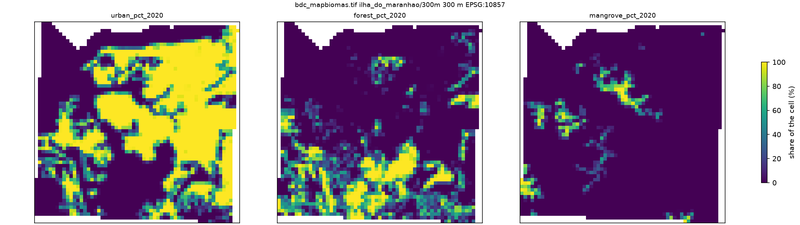
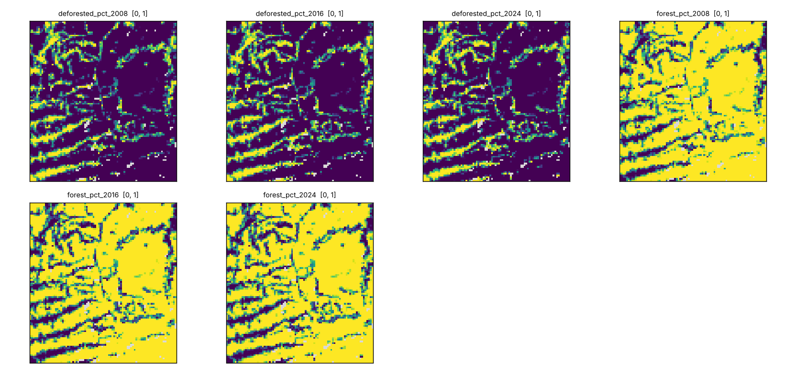
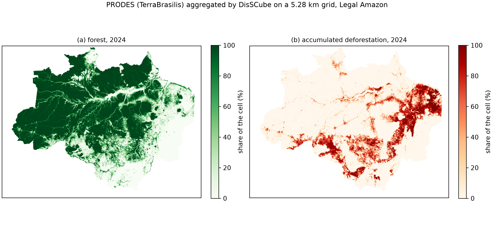
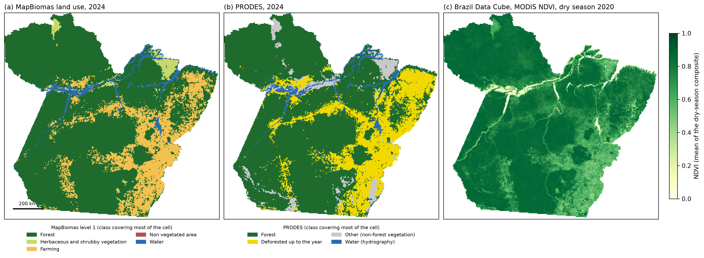
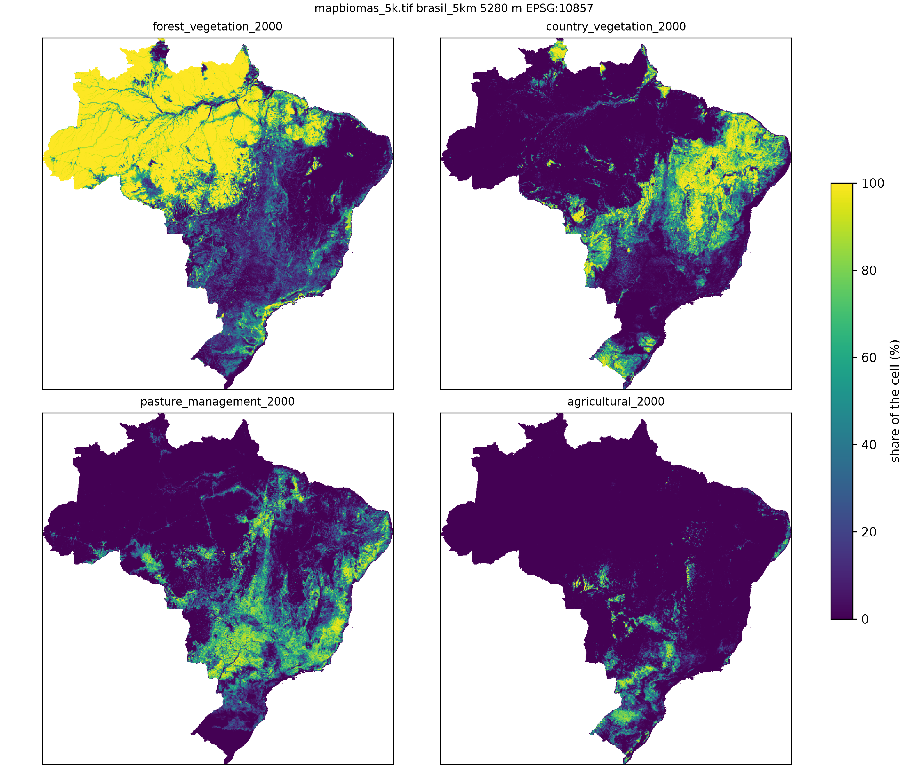

# disscube-grids

[](https://doi.org/10.5281/zenodo.23502247)

How to build gridded variables from open data with
[DisSCube](https://github.com/DisSModel/disscube): one study area per folder in `cases/`, one TOML file per
grid, a few lines of shell to run it, and the maps it produces.

The point is the **grid construction**: each pipeline file states the grid (snapped to the
[Brazil Data Cube](https://brazil-data-cube.github.io/) Albers mesh), the sources and how each
variable is derived. There is no case-specific code in the pipelines. The maps are drawn with `disscube plot` (`amazonia_legal`, `brasil_5km`, `ilha_maranhao`, `br163`),
except `para`, whose figure of four sources side by side is drawn by `cases/para/figure_sources.py`.

| Area | Pipeline | Sources | Grid | Status |
|---|---|---|---|---|
| `cases/ilha_maranhao/` | `bdc_mapbiomas.toml` | BDC Landsat indices (STAC), MapBiomas, PRODES | 300 m, 58 × 59 cells | **ran here** (14 Oct 2026, DisSCube 0.6.0): 55 s, 0.24 GB, most of it waiting for the BDC STAC |
| `cases/para/` | `sources.toml` | MapBiomas (collection 11, level-1 land use), PRODES | 5 km, whole state, 280 × 291 cells | **ran here** (20 Oct 2026, DisSCube 0.6.0): 2 min 12 s, 1.2 GB |
| `cases/para/` | `bdc_ndvi.toml` | BDC MODIS NDVI (STAC, 231 m) | same | **ran here** (20 Oct 2026, DisSCube 0.6.0): 7 min 15 s, 4.2 GB, mostly waiting for the network; panel (c) of the figure |
| `cases/para/` | `seats.toml` | Municipal seats (points, IBGE BC250 2016 through the ANA catalogue), the source of `e_cities` in the Open LUCC workflow | same | **ran here** (20 Oct 2026, DisSCube 0.6.0): 9 s, 0.21 GB; equal to an independent nearest-point calculation (checked on 19 Oct 2026), largest difference 3 × 10⁻⁸ m; panel (d) of the figure |
| `cases/br163/` | `prodes.toml` | PRODES (Legal Amazon) | 500 m, 94 × 86 cells | **ran here** (14 Oct 2026, DisSCube 0.6.0): 4 s, 0.33 GB |
| `cases/br163/` | `bdc_mapbiomas.toml` | BDC Landsat NDVI (STAC), MapBiomas | same | **ran here** (14 Oct 2026, DisSCube 0.6.0): 51 s, 0.57 GB, most of it waiting for the BDC STAC |
| `cases/amazonia_legal/` | `prodes.toml` | PRODES (Legal Amazon) | 5.28 km, whole region, 680 × 520 cells | single TOML **ran here** for the whole region (12 Oct 2026): 27 min 13 s, 2.9 GB; on 3 × 3 tiles it agrees with the earlier tile script |
| `cases/brasil_5km/` | `mapbiomas.toml` | MapBiomas (collection 11, 30 m) | 5.28 km, 900 × 1,040 cells | single TOML **ran here** for the whole country (12 Oct 2026): 1 h 43 min 55 s, 3.9 GB; on 2 tiles it agrees with the earlier tile script |

## First results (Ilha do Maranhão, 14 Oct 2026)

MapBiomas (collection 11) on the 300 m BDC-snapped grid: 3,083 of 3,422 cells have data; urban share
41.4 % (2000) → 47.5 % (2020), forest 22.8 % → 19.4 %, mangrove 4.1 % → 4.5 %, the same figures
as the earlier run in `disscube-recipes` and the run of 10 Oct 2026 (DisSCube 0.5.0). The whole file (BDC, MapBiomas and PRODES) took 54.7 s with a peak memory of 0.24 GB on 14 Oct 2026
(DisSCube 0.6.0; 7 s of CPU, the rest is waiting for the BDC STAC). The Landsat indices of the BDC (dry season 2020) cover all 3,422 cells: NDVI mean 0.32 (−0.48 to 0.86) and MNDWI mean −0.27 (−0.59 to 0.69).
The record of the run is `run_bdc_mapbiomas.log`, `run_bdc_mapbiomas.json` and `env.txt` in the folder.


The figure shows three MapBiomas bands (urban, forest and mangrove share, 2020; MapBiomas, CC BY 4.0), drawn with
`disscube plot data/bdc_mapbiomas.tif -o ../../docs/figures/ilha_maranhao_mapbiomas.png --bands urban_pct_2020 forest_pct_2020 mangrove_pct_2020 --cols 3 --shared-colorbar --crop`.
`./run.sh plot` draws every band (`cases/ilha_maranhao/images/bdc_mapbiomas.png`, git-ignored).

PRODES (edition `prodes_amazonia_legal_2025_v20260408`) returns data in 2,897 of the 3,422 cells,
so the island is inside its domain. **It is not a good demonstration**: the south-west shows a
straight-edged block that is entirely "deforested" in every year, which looks like an artefact of
the PRODES domain edge (the island lies at the limit of the Legal Amazon) and not like land cover.
The PRODES source is kept in `bdc_mapbiomas.toml` (variables prefixed `prodes_`) as the record of this test, so the island is
built from three sources in one file; PRODES is shown as a useful map on `cases/br163/` instead.

PRODES on the BR-163 near Mojuí dos Campos (500 m grid, 94 × 86 cells, all 8,084 cells with data,
3.8 s after the download, peak memory 0.33 GB, DisSCube 0.6.0, 14 Oct 2026): mean deforested share 14.5 % (2008) → 19.0 % (2016) → 32.5 % (2024); forest
85.2 % → 80.7 % → 67.2 %. The maps show the fishbone pattern of the road's side roads.
The run of 10 Oct 2026 (DisSCube 0.5.0) gave 7,997 cells with data and 18.1 % → 20.1 % → 20.5 % deforested: the PRODES reader of 0.5.0 dropped the yearly classes d2010 to d2025
(fixed in 0.6.0), so those numbers, and the figure drawn from them, are replaced.


Figure: deforested and forest share, 2008, 2016 and 2024 (PRODES/INPE, CC BY-SA 4.0), drawn with `disscube plot data/prodes.tif -o ../../docs/figures/br163_prodes.png --cols 3 --shared-colorbar --crop`.
`./run.sh plot` writes the same bands to `cases/br163/images/prodes.png` (git-ignored).

### Three sources on one grid (BR-163)

`cases/br163/bdc_mapbiomas.toml` uses the same area and 500 m grid as `cases/br163/prodes.toml` (the LuccME Lab15 cellular
space), so that the Brazil Data Cube (Landsat NDVI, dry season 2020), MapBiomas (collection 11) and PRODES can be read
cell by cell. `./run.sh plot bdc_mapbiomas` draws their bands with `disscube plot`. It is an illustration of how the same declarative
file starts from different open sources, not a validation: the sources define forest differently and are not expected to
agree cell by cell.

Run of 14 Oct 2026 (DisSCube 0.6.0): 50.9 s, peak memory 0.57 GB (20 % of one CPU core; the rest is waiting for the STAC). The Landsat NDVI of the dry season of 2020 has data in all 8,084 cells (mean 0.81, 0.26 to 0.88).
MapBiomas gives forest 88.0 % (2008) → 71.2 % (2024) and pasture 7.8 % → 20.1 %; PRODES forest is 85.2 % → 67.2 % (previous paragraph). The sources move in the same direction and differ in level, as their definitions of forest differ.

Two things found while running, in DisSCube 0.5.0: `disscube export` as a separate command
looks the grid up by its name (`ilha_do_maranhao`) while the cube stores `ilha_do_maranhao/300m`, and
fails (`Derived variable not found: ndvi_mean on grid ilha_do_maranhao`); it still does in 0.6.0 (checked on 14 Oct 2026).
`run --output` exports correctly, which is what `run.sh` uses. And the process ended with an
`Error in sys.excepthook` message after the work was done (output complete); its cause, a source raster that was
never closed, is fixed in 0.6.0.

### PRODES over the whole Legal Amazon (`cases/amazonia_legal/`)

One pipeline file, `prodes.toml`, for the whole region: PRODES (2008 and 2024) on the BDC Albers mesh, 5.28 km cells (680 × 520, the
cells of the BDC_SM tiles). The PRODES raster has 9.7 billion pixels, so it needs a DisSCube that reads and aligns by blocks (0.6.0 or later,
[DisSModel/disscube](https://github.com/DisSModel/disscube)); 0.5.0 stops for lack of memory. Bands: `prodes_deforested_pct_<year>`, `prodes_forest_pct_<year>`.
`./run.sh plot` draws the map with `disscube plot` (`docs/figures/amazonia_prodes.png`), without a script of its own. This replaces the tile script that ran the same pipeline 884 times
(`build_prodes_amazonia.py`); on a window of 3 × 3 tiles the two agree to 0.4 % of a cell at most.

**Whole region, 12 Oct 2026** (DisSCube commit `9aa7515`, the code that became 0.6.0; see "Versions" below): 27 min 13 s on one CPU core, peak memory 2.9 GB, four passes
(one per derivation) of 496 blocks each, with the PRODES archive already in the cache. The mean share of accumulated deforestation over the cells is
14.5 % at the end of 2008 and 17.0 % at the end of 2024. GeoTIFF SHA-256 `bc5de6aca978…871dab`; the hashes of the pipeline and of the sources are in `data/prodes/run.json`.
The figure is the quick look of `./run.sh plot` (`disscube plot --shared-colorbar --crop`): (left) accumulated deforestation and (right) forest, 2024.


```bash
cd cases/amazonia_legal && ./run.sh all          # validate, run (network), export GeoTIFF, plot
```

## The state of Pará (`cases/para/`)

One pipeline file, `sources.toml`, for the whole state: MapBiomas 2024 (30 m) and PRODES 2024, on a 5 km grid snapped to the BDC
Albers mesh. Pará lies entirely inside the Legal Amazon, so PRODES covers all of it. Each window is about 2.2 billion pixels, so it
needs a DisSCube that reads and aligns by blocks (0.6.0 or later,
[DisSModel/disscube](https://github.com/DisSModel/disscube)). 0.5.0 stops for lack of memory; the same file on the Acre (430 million pixels, 1 km) ran with 1.3 GB.

- **Land use:** `l1_class` is the MapBiomas class that covers most of the cell, at **MapBiomas level 1** (1 Forest, 2 Herbaceous and
  shrubby vegetation, 3 Farming, 4 Non vegetated area, 5 Water), through `[derive.params.groups]`, a list of leaf codes per class
  ([Collection 11 legend codes](https://brasil.mapbiomas.org/downloads/codigos-de-legenda/)). Code 91 appears in the 2024 map and is
  placed under non-vegetated area by assumption: check it in the legend CSV. For the share of the cell in a class instead of the
  dominant one, `percentage` takes a list: `class_code = [3, 4, 5, 6, 49]`.
- **PRODES:** `prodes_class` is the class that covers most of the cell: forest, deforested up to 2024, other (non-forest vegetation) and
  water (hydrography, kept apart by `water = 4` in `[source.codes]` of the source; without it the default map folds it into other; clouds are no data). For the deforested share, `percentage` with `class_code = 2`.
- `figure_sources.py` draws the sources side by side (`docs/figures/para_sources.png`): (a) MapBiomas level-1 land use, (b) PRODES classes,
  with `--bdc` pointing to the GeoTIFF of `bdc_ndvi.toml`, (c) the BDC NDVI and, with `--seats` pointing to the GeoTIFF of `seats.toml`, (d) the
  distance to the nearest municipal seat (the seats are drawn as dots; the file is downloaded once into the DisSCube cache and checked against its SHA-256, `--seats-zip` gives a local copy).
  With the four panels the layout is 2 × 2, otherwise one row. Cells outside the state are masked using the IBGE
  boundary ([`PA_UF_2025.zip`](https://geoftp.ibge.gov.br/organizacao_do_territorio/malhas_territoriais/malhas_municipais/municipio_2025/UFs/PA/PA_UF_2025.zip), IBGE territorial mesh 2025), which the script downloads once into the DisSCube cache and checks against its SHA-256 (`--state-zip` gives a local copy); the file is not kept in the repository.
- `seats.toml` is a point source on the same grid: the 5,570 municipal seats (IBGE BC250, 2016, through the ANA metadata catalogue), the same file and the
  same operator (`distance`, measured in EPSG:5880, in metres) as the variable `e_cities` of the
  [Open LUCC workflow](https://github.com/LambdaGeo/open-lucc-workflow). It is small (one file of about 2 MB) and shows the third kind of source, a vector layer of points,
  declared like the raster sources of `sources.toml` and the BDC source of `bdc_ndvi.toml`. The distance is computed for every cell and the figure masks those outside the
  state; there are no seats outside Brazil in the file, so the distance is large in the north of Pará, near the border, where there are no seats.
- `bdc_ndvi.toml` is the Brazil Data Cube NDVI on the same grid (dry season 2020), from the MODIS cube (`mod13q1-6.1`, 231 m): the
  Landsat cube (30 m) over the whole state does not fit, because the BDC adapter reads every scene of the period whole. Run it
  (`./run.sh run bdc_ndvi`, network) and `./run.sh plot sources` adds it as panel (c). The collection id and the asset name are those of the
  [BDC STAC catalog](https://data.inpe.br/bdc/stac/v1/collections/mod13q1-6.1).

**Runs of 20 Oct 2026** (DisSCube 0.6.0 release, one CPU core; the records are `run_sources`, `run_bdc_ndvi` and `run_seats` in the case folder, with the SHA-256 of every source): `sources` took 2 min 12 s with a peak memory of 1.2 GB (36 % of one core); `bdc_ndvi` took 7 min 15 s with a peak memory of 4.2 GB, mostly waiting for the network (7 % of one core): its peak is the highest of the runs on this page; `seats` took 9 s with 0.21 GB. The first runs of the state, of 12 Oct 2026 (DisSCube commit `9aa7515`, the code that became 0.6.0), took 5 min 44 s and 2.1 GB for `sources` and 2 min 48 s and 4.1 GB for `bdc_ndvi`; the cache, the network and the code were not the same in the two runs. By cell, forest is the MapBiomas class that covers most of the cell in 75 % of the cells of the state, farming in 19 %, water in 3 %, herbaceous and shrubby vegetation in 2 % and non-vegetated area in 0.1 %.


```bash
cd cases/para && ./run.sh run sources && ./run.sh run bdc_ndvi && ./run.sh run seats && ./run.sh plot sources   # network; the BDC and seats steps are optional (panels c and d)
```

## MapBiomas over the whole of Brazil (`cases/brasil_5km/`)

One pipeline file, `mapbiomas.toml`: MapBiomas collection 11 (30 m, year 2000) on the 5.28 km grid of Brazil (900 × 1,040 cells), seven land-use shares per cell. The source window
has 154,470 × 146,501 pixels (22.6 billion). The classes are our own grouping, not those of LuccME-BR (`cases/brasil_5km/README.md`).

**Whole country, 12 Oct 2026** (DisSCube commit `f2feb95`, the code that became 0.6.0; see "Versions" below): 1 h 43 min 55 s on one CPU core, peak memory 3.9 GB, seven passes over the
source (one per class). GeoTIFF SHA-256 `3d7ef2f6…92ff72`. The figure is `./run.sh plot` (`disscube plot --shared-colorbar --crop`), four of the seven classes:
`forest_vegetation`, `country_vegetation`, `pasture_management` and `agricultural`. It is a visual check of the output, not a validation.


## Run

```bash
python -m venv .venv && source .venv/bin/activate
pip install -r requirements.txt
cd cases/ilha_maranhao && ./run.sh all            # validate, run (network), export GeoTIFF, plot
cd ../br163 && ./run.sh run prodes && ./run.sh run bdc_mapbiomas && ./run.sh plot bdc_mapbiomas   # three sources on one grid
./run.sh validate bdc_mapbiomas             # any step, any pipeline of the folder
```

To run a pipeline **and keep its record** (log with the `time -v` summary and a summary of every band, the `run.json` of DisSCube and `env.txt`, written in the case folder):

```bash
scripts/record_run.sh ilha_maranhao bdc_mapbiomas     # needs GNU time (apt install time); refuses to run if the installed DisSCube is not the pinned release
```

Each case keeps the record of its run: the log (with the `time -v` summary), `env.txt` (machine and versions) and the `run.json` of DisSCube (pipeline, sources and derived variables with their SHA-256, DisSCube version, start and end), with the path of the repository replaced by `<repo>`. The first runs keep `run.log` and `run.json`; the runs made with `scripts/record_run.sh` keep `run_<pipeline>.log` and `run_<pipeline>.json`. The workspace `data/` is not versioned.

Times and memory were measured on one desktop computer (Intel Core i7-7700T at 2.90 GHz, 15 GiB of RAM, Ubuntu, Python 3.12.3) with `/usr/bin/time -v`;
peak memory is the peak resident set size, in GB of 10^9 bytes. Single runs: they say nothing about the speed of other tools.

Quick looks are written to `<area>/images/<pipeline>.png` (git-ignored; the ones shown in this README are
copied to `docs/figures/`).

## What each area tests

- **Sources with different geometry on one grid:** BDC composites (raster, STAC), MapBiomas
  (30 m classes), PRODES (Legal Amazon only, years from 2007).
- **Cost:** `brasil_5km` is the large case: MapBiomas at 30 m over Brazil is about 22.6 billion pixels. It is one TOML that needs a
  DisSCube reading by blocks (0.6.0 or later); with 0.5.0 it does not fit in memory.

## Versions

`requirements.txt` pins the release DisSCube 0.6.0 (10.5281/zenodo.23365403). The runs of two large cases (Legal Amazon, Brazil) were made on 12 Oct 2026, before
the release, on commits of the branch that became 0.6.0: `9aa7515` (Legal Amazon) and `f2feb95` (Brazil). The three pipelines of the state of Pará were run again on 20 Oct 2026 with the release. Compared with the release, the code differs in the repair of invalid
polygons of vector sources, the closing of the source files, the DisSCube version written to `run.json` and, for `f2feb95`, the `disscube plot` command; `9aa7515` already
has the PRODES fix of the yearly classes. Neither of these two cases reads a vector source, so none of the repairs applies to them. The small cases (Ilha do Maranhão, BR-163)
were run again on 14 Oct 2026 with the release 0.6.0 (`scripts/record_run.sh`; the records are `run_<pipeline>.log`, `run_<pipeline>.json` and `env.txt` in the case folders); their first runs, of 10 and 11 Oct, used 0.5.0. A run made with 0.6.0 records `"disscube": "0.6.0"` in its `run.json`; the records of the earlier runs do not have that field, and `env.txt` has the commit.

## Notes

- Data are fetched from the providers when a case runs; the repository holds text and a few images.
  Check each provider's terms before reusing the data (summary in [THIRD_PARTY.md](THIRD_PARTY.md)).
- BDC and PRODES results depend on the catalog contents and on the PRODES edition when the case is
  run; each run records them in `run.json` and in `*.provenance.json`.
- Code and configuration: MIT. The figures in `docs/figures/` follow the licence of the data they show
  (CC BY 4.0 for MapBiomas; CC BY-SA 4.0 where PRODES appears). Sources, licences and how to cite them: [THIRD_PARTY.md](THIRD_PARTY.md).

## Cite

Costa, S. S. (2026). *disscube-grids: building gridded variables from open data with DisSCube* (Version v1.1.0) [Computer software]. Zenodo. https://doi.org/10.5281/zenodo.23502247

The DOI above is the one of version 1.1.0 (version 1.0.0: https://doi.org/10.5281/zenodo.23368071). The Zenodo record also lists the concept DOI, which always points to the latest version. Cite DisSCube itself (10.5281/zenodo.23365403) and the data providers as well (see [THIRD_PARTY.md](THIRD_PARTY.md)).
